# Digital Museum Guide

QR based museum guide with visitor pages and an exhibit management dashboard.

## What it does

- Visitors scan exhibit QR codes to open media rich guides.
- Museum staff manage exhibits, galleries, media, and QR placards.
- Includes web and Android app workflows.

## Getting started

Install dependencies in `backend/` and `frontend/`. Copy `backend/.env.example` to `backend/.env`, set a unique `JWT_SECRET`, and set `SEED_ADMIN_PASSWORD` if you want an initial admin account. Run `npm run dev` in both directories.

## Security

Keep credentials in local environment files. The example files contain placeholders only. Rotate any credential previously used in a local deployment before publishing or redeploying.

## License

The project code is licensed under AGPL-3.0-only. See [LICENSE](LICENSE).
